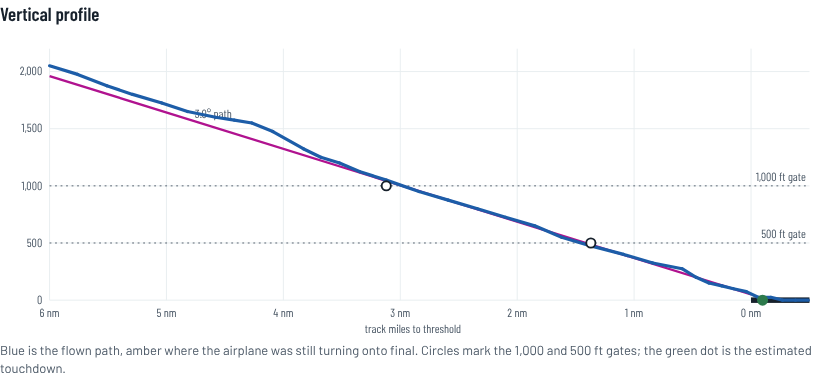

# Score my landing

Stabilized-approach scores for every landing by every Cirrus SF50, built from open ADS-B data and published at **https://jhitchco.github.io/scoremylanding/**.

Each arrival is checked at the 1,000 ft and 500 ft gates: lined up, on a 3° path, sink under 1,000 fpm, speed within limits. Threshold crossing, touchdown point and float are scored too. Surface wind, gusts, winds aloft, night, IMC and runway length are shown as context for a fast or high arrival. The home page ranks the whole fleet; each aircraft has its own debrief with a percentile against the rest.



## How it works

```
adsb.lol daily archive (3.5 GB, streamed) ─┐
FAA registry: every US SF50 ───────────────┤  debrief.collect                 data branch (encrypted state)
OurAirports runways ───────────────────────┼─> detect landings, measure  ──>  data/public/*.json  ──> GitHub Pages
IEM METARs, Open-Meteo winds aloft ────────┘  gates, estimate IAS             (anonymized)          site/ scores at your Vref
```

- `.github/workflows/collect.yml` runs every 3 hours. It takes the newest days not yet processed (yesterday first, then backfilling to `BACKFILL_SINCE`), streams each day's adsb.lol archive, keeps only the registered SF50s, and scores every landing.
- State lives on the `data` branch as one encrypted file per aircraft. Each run regenerates the public files from it, runs a privacy gate, and deploys the site.
- Scoring lives only in `site/score.js`, so the Vref slider re-scores everything in the browser, and `tools/summarize.js` uses the same code to build the fleet leaderboard.

## Privacy

- Aircraft appear under a pseudonym such as `sf50-7c3a9e12`, an HMAC of the ICAO address with a secret key. A plain MD5 or SHA would not do: there are only about 700 SF50 tails, so anyone could hash them all and reverse the list.
- Not published: tail numbers, ICAO addresses, owners, exact times, raw METARs.
- For aircraft on the FAA LADD or PIA lists, airports and runways are withheld as well.
- `tools/privacy_check.py` fails the deploy if any registry tail or ICAO address, timestamp, METAR or identity field reaches the public files.
- The site owner can unlock the real names in the browser with the `SML_SECRET` value. The site decrypts `data/names.bin` and `data/ac/<id>.bin` locally with WebCrypto; nothing is sent anywhere.

Pseudonyms hide tail numbers, but someone who already knows where and when a given airplane flew could still match it to its landing history.

## Setup

1. Add a repository secret `SML_SECRET` with a long random value. Keep a copy: it is the key to the encrypted state and to the owner unlock. Changing it renames every pseudonym and orphans the saved state.
2. Settings, Pages: set Source to "GitHub Actions".
3. Run the "Collect landings and publish" workflow once by hand, or wait for the schedule.

## Run it locally

```
pip install cryptography
export SML_SECRET=...                       # PowerShell: $env:SML_SECRET="..."
python -m debrief.collect --data data --day 2026-10-03
node tools/summarize.js data/public
mkdir _site; cp -r site/* _site/; cp -r data/public _site/data
python -m http.server -d _site 8080
```

For a private, on-demand lookup of any single tail from ADS-B Exchange (your own aircraft, for example), the Docker server in `server/` still works: `docker compose up -d`, then search a tail number on http://localhost:8000.

## Data sources and licenses

| Source | Used for | Terms |
|---|---|---|
| [adsb.lol](https://adsb.lol) open data | Tracks for the public site | ODbL 1.0. The scored data published here is shared under the same license. |
| FAA releasable aircraft database | Which ICAO addresses are SF50s | Public |
| OurAirports | Runway thresholds | Public domain |
| Iowa Environmental Mesonet | METAR history | Free |
| Open-Meteo | Winds aloft | Free tier with a daily limit; falls back to surface wind |
| ADS-B Exchange | Docker on-demand mode only | Personal use; not used for the public site |

Accuracy: airspeed is estimated from groundspeed minus modeled wind (about ±5 kt). ADS-B has no flap, gear, power or indicated airspeed. Heights use GPS altitude in 25 ft steps. Where receiver coverage stops before touchdown (common at small fields), the gates are scored and touchdown is not.
